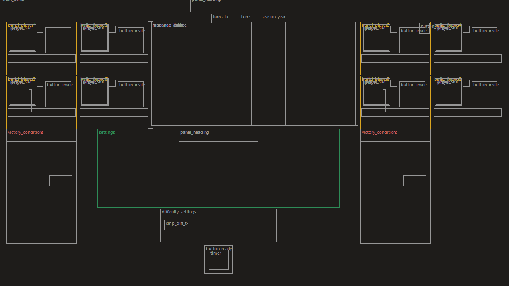

# Shogun 2: 8-player co-op campaign (experimental)
**by Tasman Modding**

Builds on the 4-player campaign mod. Installing this one removes the 4-player mod first.

## What it does
| | |
|---|---|
| **Up to 8 players** | The multiplayer campaign lobby has 8 player slots (two rows, 4 each side of the map) and the host session accepts 8 players. 8 is the engine's limit: its multiplayer battles are built for at most 8 (4v4). |
| **Player count** | The lobby title shows how many players have joined, e.g. "Eight Player Campaign (3/8)". |
| **Co-op team for every player** | In co-op, every human player is on the co-op team (can't attack each other, shared co-op rules), not just players 1 and 2. AI clans are never on it: you can ally with them, or break alliances, normally. |
| **Battles with 3–8 players** | Players who aren't in a battle follow a player who is (as in the 2-player game) instead of the game closing. Works in co-op and in head-to-head, where any two players can fight each other. Leaving a battle early no longer drops you from the campaign. |
| **Load screen shows every player** | Selecting a multiplayer save lists all its players (clan and name), four down each side of the map, instead of only two. |
| **Kick and invite buttons** | Every slot's kick button works and kicks that player, and every empty slot's invite button opens the friends list (the host sees them; the original game only wired one). The lobby is titled "Eight Player Campaign". |
| **Battle result for allies** | Fixed: players who weren't in a battle were shown the *defender's* result. When your side attacked and won, your allies saw "defeat"; when it defended, they saw "victory". Now they see the result of the ally who fought. |
| **Gift units to spectators** | Each press of the gift button sends the selected units to the **next spectator in turn** (in join order); only that player can command them, and they can hand units back. (The original game only handled one spectator: units went to the first, everyone could command them, or they were lost.) |
| **Desync: save screen bug** | Opening the Save or Load screen switched that PC's maths and text rules to its Windows language for the rest of the session (e.g. decimal comma on German, Czech, French or Russian Windows), so it no longer matched the other players. This is why "only the host should save" helped. Fixed: those screens now only change how dates are shown. |
| **Desync: floating-point drift** | The game never locked the CPU's floating-point settings, so anything that changed them on one PC (overlays, anti-virus, drivers, alt-tabbing) made that PC calculate slightly differently. Fixed: the settings are reset to the game's defaults every frame and every battle tick. |
| **Desync recovery** | If a campaign goes out of sync, nobody is dropped: the resync starts by itself (as soon as everyone is back on the campaign map, e.g. after a battle) and every player joins it. |
| **Host resync key: Ctrl+Shift+F9** | If the campaign looks wrong or is stuck (one PC stuck on an AI's turn while another shows a player's turn, armies in different places), the **host** presses **Ctrl+Shift+F9** on the campaign map. Everyone gets the host's copy of the campaign, the same way a detected desync is fixed. Wait for the resync popup to finish. It does nothing in battles or the menus, and nothing if a client presses it. |
| **Crash reports** | If the game crashes during a multiplayer game, it writes `eightplayer_crash.txt` in the game folder (where the crash happened in the game's code). Send that file with your bug report. An instant close with no error is not a crash and leaves no file: report it anyway. |
| **Battle desync: no more kick** | A battle can't be resynced, so the game used to drop the out-of-sync player. Now the battle carries on for everyone. The out-of-sync player's view may drift (a unit alive on their screen that is dead for others). Back on the campaign map, the host's state is copied to everyone by the campaign resync. |

## Community
Join the **Tasman Modding Discord** for help, finding players, bug reports and updates: https://discord.gg/medh2d8nk

## Install / uninstall
1. Everyone closes Shogun 2.
2. Double-click **`Install.bat`**. It finds the game in your Steam folders. If yours is somewhere else, run
   `powershell -ExecutionPolicy Bypass -File install.ps1 -GamePath "D:\...\Total War SHOGUN 2"`.
3. Start Shogun 2 from Steam and host a multiplayer campaign.

**Updating:** every new version is published on [GitHub](https://github.com/TasmanModding/Shogun2-8Player-Coop/releases/latest). Steam Workshop can only share `.pack` files, so it can't update the engine part of the mod for you. Download the newest zip, unzip it and run `Install.bat`: it replaces the old version. New versions are announced in the [Discord](https://discord.gg/medh2d8nk). Update together with your friends, since everyone needs the same version.

**`Uninstall.bat`** puts everything back. Steam's "Verify integrity of game files" also restores the original DLL.

At the end the installer prints a **MATCH CODE** (8 letters/digits). Everyone compares it: the same code means the same game files, including any other mods. A different code means someone has a different mod enabled, which causes desyncs; the installer also warns about other enabled mods.

Everyone must also end up with the same two hashes, or they can't join each other. The installer prints them:

| File | SHA-256 |
|---|---|
| `empire.retail.dll` | `C58F273F2E6D0A18F6AF6CA756D0812496FF75FB9C222038DEC94919FF493084` |
| `data\eightplayer_coop.pack` | `983F63E02958AF253B911934680AEE736CED160B2BB9FC152023EBCF479853F5` |

## Before you play
- **About VAC (anti-cheat):** Steam no longer lists Valve Anti-Cheat for Shogun 2. The VAC label was added to the store page on 29 April 2026 and removed again on 21 July 2026. That's good news, but this mod still changes the game's engine file, so stay sensible: play with friends, and use a spare account if you want to be extra safe.
- It only works on the current Steam version of the game; the installer refuses anything else.
- Start with the main Sengoku Jidai campaign. Rise of the Samurai and Fall of the Samurai have special clan rules in the lobby.
- To give desyncs fewer chances: everyone has **no other mods** enabled and the **same game version**.
  If one still happens, copy everyone's `logs` folder: that shows exactly what drifted.

## If something goes wrong
| Problem | Fix |
|---|---|
| "Out of sync" popup on the map | Nothing to do: the resync runs by itself. |
| Stuck turn, or players see different things on the map | Host presses **Ctrl+Shift+F9** on the campaign map. |
| Desync during a battle | Keep playing; when you're back on the map the resync fixes it (host can press Ctrl+Shift+F9 to be sure). |
| Can't join, or desyncs straight away | Compare MATCH CODEs; turn off other mods until they're the same. |
| A game crashed | Everyone quits; the host loads the newest save and sends it to the others (only the host saves). |

## Test plan
Please report the step where it breaks, what you saw, and copy the newest files from the game's `logs` folder.
1. Host alone: the lobby shows 8 slots (two rows of four).
2. Players 2–8 join: each lands in their own slot with name and clan. The host's kick button on a slot kicks that player.
3. Everyone picks a different clan and readies up; the campaign starts for everyone, and every human clan is human-controlled.
4. Play a few turns: the turn passes through every human.
5. One human fights a battle and the others watch. When it ends, **everyone** sees the same result.
6. In that battle, with 2+ spectators: select units and press gift. The first press goes to spectator 1, the next press to spectator 2, and so on. A spectator presses gift on units they hold to hand them back.
7. If "out of sync" appears on the campaign map: the resync should start on its own and the game carry on afterwards. In a battle: nobody is dropped and the battle carries on.
8. Save, quit, resume.
9. Player 3 (or higher) attacks an AI army. The players not in the battle stay in the game and follow the battle.
10. Head-to-head, 3+ players: player 1 attacks player 3 (a field battle, then a siege). The others stay in the game.
11. Co-op: in Diplomacy only the human players are co-op allies; you can make and break alliances with AI clans. Player 1 can't attack player 3's army.
12. A non-host player retreats from a battle (or leaves it early): they stay in the campaign.
13. Load a 3+ player save: the Load screen lists every player.
14. On the campaign map the host presses Ctrl+Shift+F9: the resync popup appears for everyone and the game carries on afterwards.

## v1.9: please test and report
**Fixed in v1.9:**
- **Players dropped after a battle.** When a co-op battle ended, a desync was found while the game was still switching back to the campaign map. The resync couldn't start yet, so the game dropped the player at once (before anyone could press Ctrl+Shift+F9). Now nobody is dropped for a desync during a campaign: the resync starts by itself as soon as everyone is back on the map, and every player joins it.

**Fixed in v1.8:** gifted units belong only to the player they were given to; the reason for an instant close is saved in `eightplayer_errors.txt`.

**Fixed in v1.7:** players outside a co-op battle follow it instead of the game closing; AI clans are no longer co-op allies; leaving a battle early no longer drops you.

**Still open: head-to-head battles between two players.** With 3+ players, when two players fight each other, the players not in the battle close. Until it's fixed, **auto-resolve battles between two human players in head-to-head games with 3+ players** (battles against the AI work). **If it happens, send `eightplayer_errors.txt`** from the game folder of a player whose game closed.

Report in the [Discord](https://discord.gg/medh2d8nk), [open an issue](https://github.com/TasmanModding/Shogun2-8Player-Coop/issues/new?template=crash_report.md) or comment on the Steam Workshop page, with: how many players, co-op or head-to-head, who was in the battle, what happened on whose screen and when, the battle type, your MATCH CODE, and `eightplayer_errors.txt` / `eightplayer_crash.txt` if there are any.
## Known limitations - please report what you see
The game was built for 2 players, so with 3–8 players some parts haven't been tested in real games yet:
- Other 2-player limits may remain in parts not yet played: turn order, reinforcements joining battles, the end of a 3+ player campaign, diplomacy between humans in head-to-head.
- With 3+ players, several players not in a battle could choose "play as AI" for the same AI army.
- In head-to-head, a player fighting a battle may be able to gift units to a player watching it (once head-to-head battles work).
- Watchers in head-to-head see the game's default battle result screen (nobody is allied).
- Save names still only mention 2 players.
- Campaigns started on v1.6 can keep wrong co-op settings for AI clans: start a new campaign.
- More players means more chances of a desync, and the game always waits for the slowest connection. The automatic resync and the host's Ctrl+Shift+F9 key help.

**If the game closes instantly with no error:** that isn't a crash, so no `eightplayer_crash.txt` is written: the game found a problem and closed itself. Since v1.8 the reason is saved in `eightplayer_errors.txt` in the game folder. Please report it with what happened, on whose screen and when ([Discord](https://discord.gg/medh2d8nk) or [GitHub issue](https://github.com/TasmanModding/Shogun2-8Player-Coop/issues/new?template=crash_report.md)).
## Not done yet
- **Battle desyncs** no longer drop anyone, but the battle itself can't be resynced: the out-of-sync player's view may differ until the campaign map, where the host's state wins.
- Two known causes are fixed (above); others may remain. Possible: Intel and AMD CPUs can give slightly different
  results for sine/cosine instructions the battle code uses. If a desync still happens, send every player's `logs` folder.

## Files
| Path | What |
|---|---|
| `Install.bat`, `Uninstall.bat`, `install.ps1` | installer / uninstaller |
| `build_lobby_layout.ps1`, `build_load_layout.ps1` | build the 8-slot lobby and the 8-player Load screen from your own copy of the game |
| `lib\Patcher.cs` | builds the patched engine DLL (checks the original first) |
| `lib\LayoutTool.cs`, `lib\PackTools.cs`, `lib\PackWriter.cs` | read/write UI layouts and `.pack` files |
| `verify_load.ps1` | loads a patched DLL with Windows' loader (no code runs) and checks every patch |
| `preview\` | schematic of the lobby (boxes only, no game artwork) |
| `NOTES.md` | reverse-engineering notes |

**Download:** get the zip from the [Releases page](https://github.com/TasmanModding/Shogun2-8Player-Coop/releases/latest). It contains no game files: the installer builds the mod from your own copy of the game.
